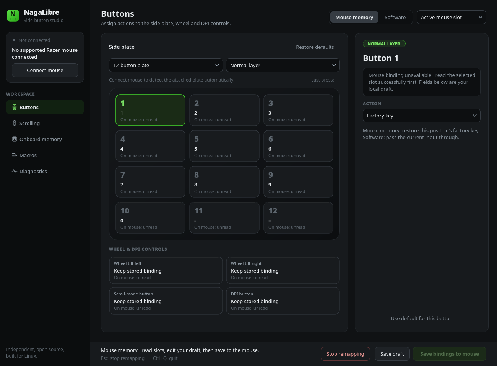

<p align="center">
  
</p>

<h1 align="center">NagaLibre</h1>

<p align="center">
  <strong>Your Naga. Your buttons. Linux native.</strong>
</p>

<p align="center">
  <a href="https://github.com/tylxr59/NagaLibre/releases/latest"></a>
  <a href="#-requirements"></a>
  <a href="#-development"></a>
  <a href="LICENSE"></a>
</p>

<p align="center">
  <a href="#-features">Features</a> ·
  <a href="#-quick-start">Quick start</a> ·
  <a href="#-set-up-your-buttons">Set up your buttons</a> ·
  <a href="#-troubleshooting">Troubleshooting</a>
</p>

---

NagaLibre is a free and open-source reimplementation of the Razer Naga side-button
system for Linux. It lets you bind the thumb buttons to keys, shortcuts, and
macros through a Qt desktop app, with a Rust engine handling the mouse.

The verified target is the **Razer Naga V2 Pro**. Experimental software support
also recognizes the Naga Pro, Trinity, X, Left-Handed, Chroma, V2 HyperSpeed,
and Viper V2 Pro. On the V2 Pro, you can save supported bindings to the mouse’s
onboard memory so they keep working after you close the app. Software mode
supports macro sequences and experimental models.

<p align="center">
  
</p>

> [!NOTE]
> NagaLibre works independently of Synapse and OpenRazer. It is an independent project, unaffiliated with Razer.

## 🎯 Features

| Feature                       | What it does                                                                           |
| ----------------------------- | -------------------------------------------------------------------------------------- |
| 🖱️ **Side-plate bindings**    | Bind the 12-, 6-, and 2-button plates to keys, shortcuts, and mouse buttons.           |
| 💾 **Onboard memory**         | Save bindings to the Naga V2 Pro so they keep working after you close the app.         |
| ⌨️ **Software macros**        | Run multi-step sequences with delays while the background helper runs.                 |
| 🔀 **Hypershift layers**      | Edit a second layer of assignments and save it to the mouse.                           |
| 🛞 **Wheel and DPI controls** | Rebind the wheel tilts, scroll-mode and DPI buttons, and pick HyperScroll presets.     |
| 🔌 **Plate detection**        | Detects faceplate swaps and switches to that plate's draft.                            |
| 🛡️ **Careful writes**         | Backs up before every save and reads the result back to check it.                      |
| 🔐 **Unprivileged app**       | The Qt app never runs as root. A polkit prompt grants mouse access to the Rust helper. |

### Support status

Hardware verification below refers to the Naga V2 Pro.

| Feature                                       | Support                                                                                                                                                                       |
| --------------------------------------------- | ----------------------------------------------------------------------------------------------------------------------------------------------------------------------------- |
| 12-button plate                               | Main development and testing target                                                                                                                                           |
| Onboard key bindings                          | USB save, app exit/reconnect persistence, and exact backup restore tested on one mouse and slot                                                                               |
| Onboard shortcuts and mouse-button outputs    | Ctrl+A, modifier release and right-click output physically tested over USB and receiver, with exact backup restore                                                            |
| Software keys, shortcuts, and macro sequences | Available while the background helper runs                                                                                                                                    |
| Automatic faceplate detection                 | USB detection verified for 12-, 6-, and 2-button plates, including swaps                                                                                                      |
| 6- and 2-button bindings                      | Input learning in software mode; remapping still needs physical testing                                                                                                       |
| 2.4 GHz receiver                              | Twelve-button onboard save, physical shortcut/mouse outputs, power/reconnect persistence and exact restore tested                                                             |
| Bluetooth onboard programming                 | Unsupported                                                                                                                                                                   |
| New onboard slots                             | Wired Naga V2 Pro, 12-button plate                                                                                                                                            |
| Standard wheel modes                          | Five HyperScroll presets, active selection and cycle order over USB; preset feels/cycling physically tested, desktop flow covered by automated tests; Custom editing deferred |
| DPI stage values and RGB settings             | Not implemented                                                                                                                                                               |
| Multi-step macros stored on the mouse         | Not implemented; use software mode                                                                                                                                            |
| Hypershift assignments                        | Normal/Hypershift GUI drafts and paired backups; wired twelve-button GUI save, hold/release, reconnect and exact restore verified                                             |
| Media and scrolling assignments               | Seven media actions and four scroll directions in the wired twelve-button editor; automated transaction/recovery coverage, physical output unverified                         |

See [the Hypershift desktop guide](docs/HYPERSHIFT.md) for layer editing, migration,
backups and the verification procedure. The [standard wheel guide](docs/WHEEL.md)
covers preset selection, cycle order and wheel-stage backups.
The [media and scrolling guide](docs/NATIVE_ACTIONS.md) covers the experimental
native assignments and their verification limits.

This is a project under active development. Start with the USB cable and the
12-button plate for the best-tested setup.

See [TODO.md](TODO.md) for the prioritized roadmap and remaining Synapse features.

### Experimental mouse models

The additional models are identified from Razer's device packages and have not
been tested on physical hardware. Connect one supported mouse and choose
**Software**. The app selects the model's layouts; use **Learn input** for each
side button before applying custom bindings. Trinity includes a seven-button
layout; fixed-layout mice select their layout automatically. Naga Pro and Trinity
plate selection is manual for now. Mouse-memory access and vendor faceplate
queries are disabled for these experimental models.

Each model keeps separate drafts. Your V2 Pro draft stays in its existing file;
other models use `~/.config/NagaLibre/devices/<model-id>/profiles.json` (or the
corresponding XDG config directory). Connect one mouse at a time for automatic
selection. Bluetooth and alternate receiver variants are unverified and excluded.

Run `./target/release/naga-macros models` to see the exact identities and
capabilities. The [model research notes](inspection/MODELS.md) record package
sources, USB IDs and evidence limits.

## 📋 Requirements

- Linux with evdev, hidraw, and uinput support.
- A current stable Rust toolchain, including Cargo, and a C linker/compiler.
- Python 3.10 or newer and **PySide6 6.8 or newer** (Qt for Python).
- Git to clone the repository.
- **polkit**, including `pkexec`, and a running desktop authentication agent for
  the mouse-access prompt. KDE Plasma normally supplies an agent.

NagaLibre is distributed as source. Build the Rust engine locally; no prebuilt
executable or Razer software is needed.

### Arch Linux / KDE Plasma

Install the dependencies below. If you already manage Rust with rustup, keep
that toolchain and omit `rust` from this command.

```sh
sudo pacman -S --needed base-devel git rust python pyside6 polkit
```

The GUI uses the distribution's [PySide6 package](https://archlinux.org/packages/extra/x86_64/pyside6/).
If your Plasma session has no authentication agent, install
[polkit-kde-agent](https://archlinux.org/packages/extra/x86_64/polkit-kde-agent/)
and ensure it runs in your desktop session.

### Other distributions

Install Rust/Cargo, a C compiler, Git, Python with venv/pip support, and polkit
through your distribution or your preferred toolchain manager. Install PySide6
from your distribution, or create a virtual environment after cloning:

```sh
python3 -m venv .venv
.venv/bin/python -m pip install -r gui/requirements.txt
```

The launcher automatically uses `.venv` when present. Your desktop also needs
the Qt platform libraries for its Wayland or X11 session.

## 🚀 Quick start

```sh
git clone https://github.com/tylxr59/NagaLibre.git
cd NagaLibre
cargo build --release --locked
./nagalibre
```

Run `./nagalibre` as your regular desktop user. **Connect mouse** opens the
password prompt for the Rust helper; the Qt app stays unprivileged. The launcher
uses the engine you built at `target/release/naga-macros`.

Button assignments, Macros and Scrolling share that authenticated connection.
Opening or closing an editor keeps the connection and stops software remapping.
Returning to button assignments refreshes stored bindings without changing your
draft. A successful onboard save or macro undo still ends the helper; reconnecting
afterwards may prompt for authentication again.

To update an existing checkout, pull the latest source and rebuild:

```sh
git pull --ff-only
cargo build --release --locked
./nagalibre
```

## 🖱️ Set up your buttons

The sidebar lists **Buttons**, **Scrolling**, **Onboard memory**, **Macros** and
**Diagnostics**, with the connected mouse and **Connect mouse** above them. The
page header holds the draft destination (**Mouse memory** or **Software**) and
slot picker. Changing pages keeps your edits and does not write to the mouse.
Stored assignments refresh when needed on Buttons or Onboard memory; other pages
skip that refresh.

Use **Buttons** for the side plate, the wheel and DPI controls, and the assignment
pane. Choose a button, then its action, including **Macro** for a saved library
sequence. **Onboard memory** holds slot management and backup recovery.
**Scrolling** contains the wheel-stage editor. **Macros** has the local library
and sequence editor (no connection is needed to author sequences) and an **On
mouse** view of stored macros and their assignments. **Diagnostics** contains
connection logs and the device support form.
**Save draft** saves local binding edits; apply/save-to-mouse activates them.
Macro assignments are drafts too: **Save bindings to mouse** uploads them and then
saves your other bindings. **Stop remapping** and Esc remain available outside an in-flight transaction.

1. Connect the mouse by USB and choose **Mouse memory** as the draft destination.
2. Click **Connect mouse**, then select an existing slot. Use **Onboard memory → Read slots** to refresh it.
3. In **Buttons**, choose a numbered button and edit its key or shortcut in the draft editor.
4. Click **Save bindings to mouse** to apply the draft to the selected slot.

Each tile distinguishes **Stored** (read from that slot) from **Draft** (your
local edits). Connecting reads stored bindings automatically. Returning to the twelve-button
plate after a swap refreshes the selected slot automatically. Reading the mouse
leaves your draft unchanged. The selected slot may be inactive; saving activates it. Saving compares all twelve draft actions
and writes only changed bindings, preserving the original bytes of unchanged
bindings. Review the entire draft before saving.

The app saves a backup before writing and reads the result back to check it.
After a successful save, it stops the helper. Saved bindings then work without
NagaLibre running.

Create reusable local sequences directly in **Macros** without connecting the mouse. Save the macro, then select a button in **Buttons**, choose **Macro**, select the sequence and playback, and use **Save bindings to mouse**; each macro is uploaded through its own journaled transaction before the other bindings are saved. Representative wired uploads, playback and desktop undo have passed physical
tests for the wired twelve-button scope; broader combinations remain experimental. See [the macro guide](docs/MACROS.md)
for supported steps, storage limits and recovery.

To remove an unassigned NagaLibre upload, open **Macros → On mouse**, choose
**Read mouse**, select its row and choose **Delete selected macro…**. Its original
upload journal is required. Button assignments and the local library are preserved;
this selected-delete path remains unverified on hardware. Entries still in use or
whose ownership cannot be established are refused.

To switch to a slot's stored bindings, select it in the dropdown and click
**Activate slot**. This leaves your draft and the stored bindings unchanged.
The app reads the target, backs up the target and previous active slot, then
switches and verifies the result. Selecting the dropdown or clicking **Read slots**
alone does not activate it. Activation currently requires normal device mode and
the detected 12-button plate; it refuses slots with unexpected primary clicks.

**Restore defaults** updates your draft to `1…9, 0, -, =` on the side plate,
horizontal scroll left/right on the wheel tilts, cycling wheel modes on the
scroll-mode button, and cycling DPI stages on the DPI button. Click **Save bindings to mouse** to apply these bindings to
the selected slot. Other plate drafts are preserved.
Mouse memory mode also has **Wheel tilt left**, **Wheel tilt right**,
**Scroll-mode button**, and **DPI button** tiles. Assign a key, shortcut,
or mouse-button action and click **Save bindings to mouse**. These controls default
to **Keep stored binding**, which preserves their existing firmware behavior.
**Factory default** and **Use default for this button** restore an individual
wheel control's standard function in the draft. These bindings are derived from
the official driver; horizontal scrolling in both directions, wheel-mode cycling
and DPI cycling have been physically verified over USB on one mouse and slot,
with exact original mapping restoration afterward. Software mode leaves their firmware
behavior intact; onboard macro sequences for these controls are unsupported.
The DPI binding uses the mouse's existing DPI stages; it does not change their
values. Device defaults and control definitions live in [devices/models.json](devices/models.json),
shared by the GUI and backend. See [the registry format](devices/README.md).
**Restore backup…** restores saved side-button records on the same mouse and
connection type, then activates their slot. Primary left/right click mappings
are never rewritten. The slot list shows the device-reported capacity and distinguishes initialized
slots from disabled, uninitialized entries—for example, “2 of 5 slots initialized.”
On the wired Naga V2 Pro with the 12-button plate, **Create slot** initializes the
next unused slot with factory bindings and leaves the current slot active. The
app backs up existing slots and checks the new defaults before selecting the new
slot. Your draft stays unchanged; **Save bindings to mouse** saves it to the new
slot and activates it. Creation is unavailable when all slots are initialized,
over the receiver, or without a successful fresh read. Creating the first profile
on a device with no initialized slots and deleting existing slots are unsupported.

### Run software macros

Choose **Software** for sequences such as a shortcut, a delay, and another key.
After **Connect mouse**, the attached plate is selected automatically and checked
once per second while the helper is connected. Swapping plates stops software
bindings and selects that plate’s draft; click **Apply bindings** when ready.
Use **Learn input** to identify side-button inputs, especially on the six- and
two-button plates. Learning ignores primary mouse clicks.

If detection is unavailable, the app allows manual selection. A detached or
unrecognized plate blocks Apply until a supported plate is attached. Detection
has been verified over USB. The twelve-button plate was also detected through
the receiver; receiver plate swaps and six-/two-button detection remain unverified.

Software mode needs the helper to stay running. Closing to the system tray keeps
it active; **Quit** stops it. With the window focused, **Esc** stops software
remapping and **Ctrl+Q** quits. Stopping software remapping leaves any saved
onboard bindings in place.

**Save draft** saves your edits locally without applying them to the mouse.
Drafts and backups normally live in `~/.config/NagaLibre/`, or under
`$XDG_CONFIG_HOME/NagaLibre/` if configured.

## 🙋 Request device support

Have an unrecognized mouse, a faceplate detection problem, or an experimental
model to test? Open the [device support issue form](https://github.com/tylxr59/NagaLibre/issues/new?template=device-support.yml).
It includes diagnostic commands and asks for the model, connection, layouts,
and observed results. The same form appears under **New issue** on GitHub and
**Request device support…** in the app. Unrecognized and experimental devices
get a hint beside that button.

Start with this passive report, which also includes unknown Razer devices:

```sh
./target/release/naga-macros diagnose > nagalibre-diagnostics.json
```

Review the file, then attach it to the issue. It omits serial numbers and reads
metadata without sending vendor commands or capturing button presses. The app
does not upload it automatically. See the [diagnostics guide](docs/DEVICE_SUPPORT.md)
for optional faceplate and input checks and what information to include.

## 🩺 Troubleshooting

- **No password prompt:** check that `pkexec` is installed and your desktop's
  polkit authentication agent is running. Run the GUI without sudo.
- **Stored: unread:** the selected slot has not been read successfully. Check
  the connection log and read it again; the draft is not the active binding.
- **Software macros produce no output:** ensure uinput is available with
  `sudo modprobe uinput`, then reconnect and apply again.
- **A software remap interferes with input:** quit the app, or use
  `sudo pkill -x naga-macros` to stop its helper. This does not undo onboard saves.
- **After unplugging or changing connections:** reconnect and read the mouse
  again. Software remapping does not resume automatically.

For a read-only diagnostic from your source build:

```sh
sudo ./target/release/naga-macros onboard-read
sudo ./target/release/naga-macros onboard-probe --slot 1
```

Diagnostic output and backups can contain your mouse serial number. Remove it
before posting output publicly.

## 👋 Development

Build the engine and run the GUI from your checkout as described in [Quick start](#-quick-start). Before sending a change, run the same checks as the maintainers:

```sh
cargo fmt --check
cargo test --locked
cargo clippy --all-targets --locked -- -D warnings
cargo build --locked
QT_QPA_PLATFORM=offscreen python3 -m unittest discover -s gui -p 'test_*.py' -v
```

GUI tests use the debug engine for config and session checks and mock hardware for interactions, so no mouse is needed.

| Guide                                         | Covers                                                        |
| --------------------------------------------- | ------------------------------------------------------------- |
| [CLI](docs/CLI.md)                            | Software macro configuration and monitoring from the terminal |
| [Macros](docs/MACROS.md)                      | Supported steps, storage limits, and recovery                 |
| [Hypershift](docs/HYPERSHIFT.md)              | Layer editing, migration, backups, and verification           |
| [Wheel](docs/WHEEL.md)                        | Preset selection, cycle order, and wheel-stage backups        |
| [Media and scrolling](docs/NATIVE_ACTIONS.md) | Experimental native assignments and their limits              |
| [Device support](docs/DEVICE_SUPPORT.md)      | Diagnostics and what to include in a report                   |

See [TODO.md](TODO.md) for the roadmap. Bugs and contributions are welcome through [GitHub Issues](https://github.com/tylxr59/NagaLibre/issues) and pull requests.

## 📦 Releases

Bump the version in `Cargo.toml`, then push a matching `v<version>` tag. The [release workflow](.github/workflows/release.yml) runs the tests, builds the `naga-macros` engine, and publishes it with a checksum to [GitHub Releases](https://github.com/tylxr59/NagaLibre/releases) with generated release notes. Building from source remains the recommended install.

## 📃 License

NagaLibre is available under the [MIT License](LICENSE).
