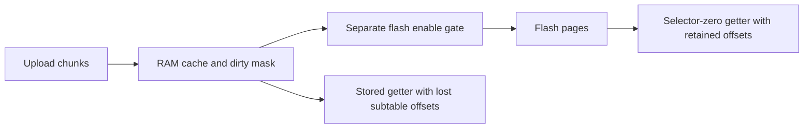

# Naga V2 Pro firmware: custom-wheel upload research

## Current readback limitation

The completed unchanged upload establishes acknowledgements and repeated getter
bytes, **not independent CW/CCW/velocity preservation**. A subsequent address-path
review found that stored-profile getters in both extracted mouse images discard
intra-page offsets. Current captures have velocity equal to the first three CW
points. Full replay from that ambiguous data is now blocked before any write;
custom editing remains paused. The installed firmware reports 1.2. A completed
slot-2 control now demonstrates aliased stored replies alongside independently
different selector-zero CCW/velocity; exact mechanism identity remains inferred. Read the investigation below
before interpreting earlier test results as a complete logical backup.

## Scope and provenance

Static inspection on 2026-10-20 of Razer's official Naga V2 Pro (`RZ01-0440x`)
firmware updater. No updater was executed, no firmware was flashed, and no live
mouse requests were issued during this research. The installed mouse later
reported major/minor 1.2 (raw 01 02); its patch and exact image remain unknown.
These findings describe the extracted image;
matching behavior on the user's device is supporting evidence, not proof of
identical installed firmware.

Sources:

- [Official updater page, answer 6394](https://mysupport.razer.com/app/answers/detail/a_id/6394/~/razer-naga-v2-pro-firmware-updater-%7C-rz01-0440x)
  lists `v2.61.01_r1`, dated August 25, 2026.
- The page's `https://rzr.to/8xek3n` link redirects to
  [NagaV2Pro_00A800A7_FirmwareUpdater_v2.61.01_r1.exe](https://dl.razerzone.com/drivers/NagaV2Pro/win/93A62DC40C26EF9439564A5456B42608/NagaV2Pro_00A800A7_FirmwareUpdater_v2.61.01_r1.exe).
- Download SHA-256:
  `77a17572b78ba0eac8dd742dc8655bbbe1308f69bbeac585f180aa3bfcda2183`.

The executable contains an extractable ZIP with `WirelessSetFWU.exe`,
`FWUpdaterDLL.dll`, and external `DeviceUpdater.resources`. The latter contains
.NET string resources named `Dev1FWLineN` / `Dev2FWLineN`, each holding an Intel
HEX record, together with line counts, product IDs and target versions. It is
not necessary to execute the updater to recover these images.

| Image | PID | Resource records | Address interval (end exclusive) | Image bytes | SHA-256 |
| --- | --- | ---: | --- | ---: | --- |
| Receiver, Dev1 | `00A8` | 3208 | `10000`–`1c850` | 51280 | `d88d7ab11467951d5d9560d32399c4b73e7d93580bffd9d5a26aaeb96429d729` |
| Mouse, Dev2 | `00A7` | 16355 | `27000`–`66dbc` | 261564 | `8adbdbdda8adc1b557c8aa770eff2016b0041477550cebf79bf73be90de7d392` |

Both metadata target versions are `2.61.01`. Every reconstructed HEX record's
byte count and checksum was verified, extended address records were applied,
and conflicting overlapping bytes were rejected. Binary hashes refer to the
address interval above, with any absent addresses filled with `ff`. Mouse reset
vector is `273c1`, initial stack pointer `200386d8`; receiver reset vector is
`104f5`, initial stack pointer `20005ea0`. These support ARM Thumb disassembly.
Addresses below are absolute firmware addresses, **not** Windows PE RVAs.

Proprietary archives, resource strings, HEX/binary images and disassembly remain
under ignored `inspection/payload/haptic-firmware/`. Do not commit them or put
firmware/update functionality into NagaLibre. The repository records independent
protocol findings and provenance only.

## Finding: custom upload has an explicit state machine

The USB feature-report class dispatcher at `46d9e` branches on class `15` at
`46dc2` and calls `4606c` at `46e1e`. The latter reads command byte 7 and payload
at offset 8 of its internal 90-byte report. Its inline branch table at `46114`
maps commands 0–4 to `46166`, `461e6`, `46250`, `46302`, `462fa`; `462fa`
branches to `46362`. This independently connects the following firmware code
to actual `15/03` and `15/04`, rather than merely similarly shaped functions.

| Operation | Firmware address | Observed behavior |
| --- | --- | --- |
| Custom configuration `15/03` | `46302` | Requires Custom selector 6, resets upload flags, parses configuration through `3b2c0`, then sets a context bit: 2 for a nonzero profile selector; 1 for selector zero. |
| Table write `15/04` | `46362` | Requires selector 6 and checks those context bits **before** accepting table data. For a nonzero profile, bit 0 must be clear and bit 1 set (`46376`–`4637e`); profile-zero uses the inverse context (`4642e`–`46436`). |
| Rejection | `46368` / `461ce` | Clears upload flags and stores status 3 in the response. |
| Chunk handler | `3a608` | Tracks table selector, next point offset and prior offset; checks capacity and accumulates chunk bytes. This is not an arbitrary isolated record writer. |
| CW completion state | `4643a` | Rejects incompatible later-stage flags and sets bit 2 once the configured CW count has been reached. |
| CCW completion state | `4644c` | Requires CW-complete bit 2, rejects a later-stage flag, and sets bit 3 on completion. |
| Velocity/final stage | `463be` | Requires both CW- and CCW-complete bits before the final path. Storage/application helpers follow; durability semantics need further tracing. |

At `46380`–`46390` start/count are byte-swapped from the two big-endian u16
fields and the points pointer is passed as payload+7. `3a608` checks the end
index against the table capacity (`3a640`–`3a650`). Its offset-tracking path is
at `3a628` and `3a814` onward; callers must not infer retry/idempotency semantics
from a lost acknowledgement alone.

`3b2c0` parses the configuration variant selected by argument 3 = 2. The count
fields populate u16 values at offsets `20`, `22`, `24` in its working state;
capacities are set to 80 each (`3b3da`–`3b3e0`). It computes the total table
byte count and selects a destination. A subsequent first CW chunk has a buffer
clear path (`3a688`–`3a6a4`). Therefore **configuration plus an eight-point
partial replay is not a safe replacement for a complete upload**.

This independently agrees with the older Windows native handler's order:
configuration, all CW chunks, all CCW chunks, then velocity chunks. See
[host-side protocol research](HAPTIC_WHEEL.md). The three extra declared bytes
in that native setter remain a host-side discrepancy; the firmware findings
here do not establish that a shorter declared length should be tried.

## Relationship to the rejected live replay

The completed `haptic-table-replay-1792503875132265771` sent isolated `15/04`
without preceding configuration. Both replay attempts received validated status
3, while readbacks verified all original captured settings and paired mappings
unchanged. The extracted firmware contains an explicit rejection path for a
missing upload context, so this is a concrete explanation consistent with that
result. It does not prove the installed version or exclude another condition.
No repeat of that test, guessed length change, configuration-only write or
partial upload is authorized by these findings alone.

## Remaining work before another custom write

1. Finish tracing all early exits, count/offset reset behavior, flash scheduling,
   and the final application/storage operation. Determine whether interrupted
   staging changes persistent settings or only a temporary buffer.
2. Establish a full original-state replay and recovery contract for configuration
   plus all three tables; preserve the original velocity bytes and metadata.
   A lost acknowledgement may have advanced the state machine. Restarting at a
   proven configuration boundary must be verified, not assumed.
3. Test that contract against the firmware control flow and fault cases before
   requesting a new bounded hardware test. Keep Custom disabled and Smooth Scroll
   active for the first complete unchanged-settings upload.
4. Read back and verify all captured state after full replay. Only then attempt
   one custom parameter change at a time, including tactile and reconnect checks.
5. Firmware consumes curves/configuration, whereas editor tension/steps live in
   metadata. Do not confuse a firmware point-count bound of 80 with the UI's
   steps-per-revolution range or claim firmware-verified tension limits.

Windows/Synapse capture is unavailable to the user. Firmware-side analysis now
provides an independent way to advance this work without requiring Windows.

## Current-device version diagnostic

The extracted USB class-0 handler branches on command `81` at `44f2e`, then
copies exactly two version bytes at `44fb6`–`44fbe`. The diagnostic requests
`00/81` with a two-byte zero payload, repeats the read and brackets it with
wired device/serial/mode/inventory/active-slot/plate guards. It preserves the
raw bytes and reports decimal components, without inferring a patch number.
A two-byte result cannot establish equality with every field of the updater's
three-component version or prove the entire installed image matches this hash.

`python3 scripts/inspect_haptic.py --firmware-version` first durably captures
all initialized slots' paired mappings, inspects wheel state, then saves the
identity-bound version diagnostic privately as `firmware.json`. It rechecks
paired mappings even if the optional version query fails. No setter, bootloader
request, firmware transfer or updater execution is involved. The user completed this diagnostic on wired USB: version bytes `01 02`,
reported as `1.2`. Its guard matches the wheel capture and the before/after
paired mapping checkpoints match. The wheel export SHA-256 remains
`f6b5d791c17307d49b585b3ff44489814f230760906fa12ccc9dacf2f0110b37`.
The firmware receipt and checksums were independently inspected. This does not
identify a patch number or establish that the extracted `2.61.01` image is the
installed firmware; retain that distinction for subsequent protocol claims.

## Older official image cross-check

To avoid relying only on the newer image when the user's mouse reports `1.2`,
also extracted the official `v1.03.00_r1` package linked by the older revision of
Razer's support page (`https://rzr.to/aiq5k1`), resolving to
[NagaV2Pro_00A800A7_FirmwareUpdater_v1.03.00_r1.exe](https://dl.razerzone.com/drivers/NagaV2Pro/win/1CF9CB3437CDE7966FC5A5E5B83C2ADE/NagaV2Pro_00A800A7_FirmwareUpdater_v1.03.00_r1.exe).
Updater SHA-256 is
`12e911b6d9fbc55dd9aa8773c470ad1979df1184b8819a474c43143a01b6a162`.
Record lengths/checksums/address extension/overlap checks also passed here.

| Image | Address interval | Bytes | SHA-256 |
| --- | --- | ---: | --- |
| Older mouse `00A7` | `27000`–`65fdc` | 258012 | `fc30fed3ae5ec85d4465ae3bbe32dbf012c0e28f6fabbfbd5752e885a9caeab8` |
| Older receiver `00A8` | `10000`–`1c7bc` | 51132 | `74232e5bd4192895cc5254d7a4e41a526097e8973a594ebf5ee06f46735764ac` |

The older mouse class dispatcher calls the class-15 handler `43e00` at `44b52`.
Its configuration path `4409e` resets flags and sets the same profile-context
bits; the table path `44104` rejects a nonzero-profile request without bit 1
set and bit 0 clear (`44124`–`4412a`). It calls chunk handler `38854`, checks
configured completion count through `387cc`, and requires CW/CCW completion
bits before the velocity path (`44168`–`44172`). Thus the configuration-first
state-machine mechanism exists in this older image as well. This is an
independent cross-version check, not a claim that either downloaded image
matches the installed `1.2` firmware exactly. Neither updater was executed.

## Complete unchanged-upload implementation

`scripts/replay_haptic_upload.py run` now prepares a fresh private all-slot
paired/wheel backup without a session commit. The hidden `haptic-upload-replay`
helper checks the entire checkpoint, fsyncs a create-new private journal holding
the original configuration and every original packet, and rechecks before any
write. Only wired 00A7, twelve-button plate, initialized active slot, Smooth
Scroll selected and Custom disabled are accepted. The first bounded format
requires the captured configuration prefix `slot 06 01 01`, zero deadzones,
40-byte metadata, three nonempty tables of at most 80 points and matching counts.
No new values, changed counts, metadata, stage selection or mappings are emitted.

For 45/45/3 points, one complete upload has 14 packets: configuration (`15/03`),
six CW chunks, six CCW chunks, and one velocity chunk (`15/04`). Table packets
retain the native `10 + 8*n` declared length with deterministic zero extra bytes.
No partial upload is treated as a completed edit. There is no firmware/bootloader
update operation here: these are the wheel-configuration setters.

After the initial pass, the helper checks all captured state, then performs a
complete original-settings recovery upload starting at configuration. It checks
all unrelated state before recovery: mappings, other slots' readable wheel state,
active position/list, browsing mode, capacities and active metadata. It does not
try to interpret possibly damaged target Custom configuration/tables as valid
stale-state evidence. Final verification uses the original unmodified reader and
requires the complete backup to match exactly.

### Offset tracking affects restart behavior

Configuration resets upload context, but does not itself reset every chunk
counter. In `3a608`, expected offset is checked at `3a628`; the previous offset
can be recognized as a duplicate (`3a814`–`3a820`). A mismatching offset clears
counters/checksum and returns failure (`3a822`–`3a832`); the USB caller clears the
context and returns status 3. A repeated first chunk can therefore be skipped,
or a restart can be rejected after an interrupted earlier table. Do not blindly
repeat a failed individual chunk or assume configuration alone resets all state.

Recovery is bounded to two full passes. It may start its second pass only after
(a) a validated `15/04` status-3 rejection during the first recovery pass, or
(b) an acknowledged complete pass whose final captured state does not match.
It rechecks unrelated state before restarting from configuration. The rejection
alone does not identify its cause; the second pass uses exactly the same original
sequence and a repeated rejection remains incomplete. No alternate length,
selector or data is tried. A lost recovery acknowledgement remains incomplete,
even if saved settings still match, because the staged upload may be unfinished.
The separate `restore --directory ...` action restarts only original recovery;
completed journals/plans are rejected rather than replayed again.

The private first journal record precedes all writes. Later recovery journal
append failures cannot prevent attempting original recovery; they are retained
in the result, and a failed final journal fsync prevents a completed caller
receipt. Initial backup/journal failures prevent initial writes. The helper and
original files must remain unchanged while any upload is outstanding.

Tests use an independent synthetic device that enforces configuration context,
table order, offsets and duplicate/rejection behavior. They cover captured
45/45/3 counts, raw velocity preservation, lost initial acknowledgements at all
14 packet positions, lost recovery acknowledgements, NaN staging corruption,
a duplicate first chunk requiring a second recovery pass, stale/unrelated state,
persistent rejection, interrupted journal/path change, completed-journal reuse,
invalid counts, and journal write failure during recovery. Python tests cover
backup-before-helper ordering, backup failure, plan kind, checksum guards,
recovery-only routing, failure receipts and preservation of original files.
These are software/fault checks, not live firmware acceptance or tactile proof.

## First complete unchanged upload: hardware result

The user completed `haptic-upload-replay-1792506242913409977` on wired USB,
with device-reported firmware bytes `01 02`. Both original 14-packet uploads
(initial and recovery) were acknowledged; initial and final full captured-state
checks passed. The recovery required one pass, with no fallback restart. The
private result contains no upload, verification or journal errors and reports
restored_exactly/probe_passed true. Original backup and helper hashes were
independently checked against the private plan. The private root journal itself
was not independently readable without sudo and was not inspected.

This establishes acceptance of the complete configuration/CW/CCW/velocity
sequence, native declared chunk lengths and exact original-data replay on the
user's current firmware. Custom stayed disabled and Smooth Scroll stayed active.
It does not establish changed custom parameters, tactile Custom output, firmware
bounds, USB reconnect persistence, or hardware recovery from an injected fault.
Those remain separate tests; the prior software fault coverage is not converted
into a physical recovery claim. There is no outstanding restoration.

Next select the existing Custom stage using the controlled stage-only trial,
observe normal operation and reconnect, then restore the exact original stage
list/selection. Establish that baseline before generating a different curve.

The user subsequently completed the existing-Custom selection baseline. Applied
readback is position 6 / ID 86 in the six-entry list; only stage selection/list
and associated raw records changed. Original configuration, tables and metadata
were preserved. Backup/helper hashes match and the restoration receipt equals
the original active-slot state exactly. The sole physical observation supplied
so far is “Smooth scrolling”. Reconnect persistence, normal clicks and original
physical behavior after restoration still need explicit observations. No trial
or recovery is outstanding. Do not infer a failed selection or a custom tension
response from that observation alone.

## Stored table address translation discards subtable offsets

On 2.61.01, getter source-pointer helper `3a414` distinguishes table selectors.
For nonzero profiles it adds CW length for CCW (`3a48e`–`3a492`) or CW+CCW
lengths for velocity (`3a448`–`3a450`), but then translates the result using only
`(pointer - 0xcd000) >> 12` (`3a454`/`3a496` onward). It rebuilds a cache-block
base without restoring the intra-page byte remainder. Therefore CW, CCW and
velocity addresses inside the same 4096-byte page resolve to the same cache
base. For 45/45/3 counts their byte offsets are 0,360,720; the lower offsets are
lost. Returned table lengths still come from separate configuration fields, so
apparently consistent headers/counts do not establish distinct table contents.

The older 1.03.00 helper `38660` has the same structure: CCW offset addition at
`386da`–`386de`, velocity addition at `38694`–`3869c`, followed by the page-only
translation at `386a0`/`386e2` and cache-base rebuild. This is a concrete firmware
mechanism consistent with the observed prefix overlap; it is not proof that
the installed 1.2 image is identical.

Selector zero follows a different, direct RAM pointer path: CW `3a488`, CCW
`3a4c6`–`3a4ca`, velocity `3a4d0`–`3a4d8`; corresponding older paths are
`386d4`, `38712`–`38716`, and `3871c`–`38724`. These retain subtable offsets.
The native custom getter accepts profile selector zero, so this is an evidenced
read-only comparison path, not a new guessed vendor command. It may expose the
current volatile tables; how they correspond to active stored profile/settings
must be established separately. Neither metadata nor a profile-zero stage list
is required for this diagnostic.

`scripts/inspect_haptic_views.py` now saves a fresh durable paired checkpoint,
reads the active stored and selector-zero table/configuration views twice with
identity guards, and verifies paired mappings afterward. It saves separate raw
records as unverified_haptic_table_views, never accepted as a restorable backup.
Bounds/echoes/stability are enforced and a rejected zero-selector getter stops
without fallback. It does not select Custom, change stages, write curves or
activate a profile.

The earlier full replay copied the reported velocity prefix as though it were
an independently captured velocity table. We should have resolved the anomalous
prefix before writing. That trial's matching readbacks cannot exclude overwriting
actual velocity data, and the original independent velocity values are unknown.
Do not infer their original contents from host defaults or silently regenerate
an assumed original. Preserve the historical receipts, record this coverage
limitation, establish current independent readback and a recovery contract,
then obtain explicit physical observations before a changed-parameter test.
The current Custom trial's smooth feel alone cannot identify its cause.

## First volatile-view hardware attempt: transport contention

The first stored/volatile comparison attempt stopped in its initial paired
mapping sweep, before the table comparison command or durable checkpoint. A
Hypershift 02/8c read timed out with a checksum-valid but unrelated 07/80 response.
Its private directory was independently checked and is empty. No settings writes
were requested and no recovery is outstanding. Read-only process/service checks
found the OpenRazer daemon user service and Polychromatic tray running; competing
control traffic is a plausible cause, not proven packet attribution. No service
was stopped by the agent. Repeat the full read-only inspection with competing
controllers temporarily inactive; retain strict response correlation.

The user also confirmed original Smooth Scroll feel returned and USB reconnect
was tested during the existing-Custom stage trial. The saved pre-restoration
checkpoint still selected stage 86/position 6. Normal scrolling/clicks were
confirmed earlier. This does not resolve independent curve-table readback.

## Completed stored/selector-zero comparison

Private receipt `haptic-table-views-1792521370834215784` records a successful
read-only comparison with OpenRazer temporarily stopped by the user. Both views
repeated stably with 45/45/3 points. CW, CCW and velocity matched across views;
velocity equaled the CW prefix in both. Before/after paired mapping checkpoints
were independently checked equal, and the helper hash matched the debug build.
No settings writes occurred. This does not distinguish an installed getter
limitation from the preceding replay having stored overlapping velocity data.

Further 2.61.01 tracing shows why selector zero must not yet be promoted to an
operational-table backup. Getter helper `3a414` uses configuration field +3c.
Application helper `3b050` copies the combined source into a working buffer at
`3b0c2`–`3b0c4`, then sets distinct operational pointers +30 (CW), +34 (CCW),
and +2c (velocity) at `3b0c8`–`3b0da`. Driver-state copy `3b0f0` uses those
three operational pointers at `3b16a`–`3b174`; it does not use +3c directly.
Configuration-copy helper `3b17c`, variant 2, preserves +3c at `3b1b2`–`3b1b8`.
The configuration parser sets +3c to a profile/stage flash address for a nonzero
profile (`3b3f4`–`3b408`) and a stage RAM buffer for selector zero
(`3b40e`–`3b41c`). Thus a RAM configuration structure alone does not establish
that its source pointer denotes the active operational buffer. Trace profile
loading and pointer replacement before an untouched-slot comparison; do not
infer restoration coverage from selector-zero equality alone.

### Combined-table loading and the existing-slot control

Helper `3ada4` iterates enabled stages (`3adb4`–`3adc8`). For a nonzero profile,
`3add0`–`3ae00` translates the combined source pointer to its cache-block base;
for selector zero, `3ae0a`–`3ae0e` uses the pointer directly. It copies the whole
configured table byte count at `3ae12`–`3ae1a` into a stage working buffer and
again at `3ae3a`–`3ae40` into a second buffer, then sets the three operational
pointers at `3ae44`–`3ae5a`. Whole-table loading from an aligned source differs
from independently translating an already-offset CCW/velocity source in the
getter: retaining the combined bytes permits independent operational tables.
The caller `3aaf0` copies a profile configuration into the selector-zero state,
calls this loader at `3ab06`, then applies the selected stage through `3b004`.
This path does not establish identical behavior on installed firmware 1.2.

`scripts/compare_haptic_slot.py` prepares a controlled comparison with an existing
slot that has not received our full curve replay, using the established paired
activation transaction. It captures both views after activation and returns to
the original slot with exact captured-state checks. It never enables Custom,
uploads curves or changes mappings. Even matching replies on this control must
be interpreted with the source-pointer uncertainty above; this experiment does
not itself create a restorable independent table backup.

## Existing-slot hardware control: independent tables are readable

Private comparison `haptic-slot-comparison-1792524816142847278` temporarily
activated existing slot 2, then restored slot 1 with exact captured-state
verification. Its hashes and before/after checkpoint equality were independently
verified. No curve/binding upload occurred. Slot-2 counts were 43/43/5;
stored/selector-zero equality was [true,false,false]. Stored CCW equaled CW and
stored velocity equaled its first five points. Selector-zero CCW was distinct;
velocity began (-720,1.5067), (-263.58,1.1962), (4.26,1.0284) and ended
(720,1.4667). These describe a five-point curve (fourth point omitted here).
This demonstrates separate tables through selector zero on the installed device.

Slot 1 still has CW-prefix velocity through both getters, strongly consistent
with the preceding full replay having stored that data. Its pre-replay
independent tables were not captured and cannot be reconstructed from the old
receipt. Slot 2 has different user settings and is not a substitute original.

The getter-only independent checkpoint command captures the legacy baseline
and both active views together, requires guard/configuration/capacity/CW
correspondence, rechecks the baseline and repeats both views. It uses a separate
kind that legacy upload deserialization rejects. Independent write verification,
stale checks and recovery must consume zero-view data explicitly before custom
uploads resume; no new writer has been enabled by this finding.

## Independent capture and replay verification

Independent checkpoint `haptic-independent-checkpoint-1792525289956879242`
passed on active slot 1, counts 45/45/3, both views equal. Its SHA-256 is
b8644306e433033cbb06dde03f6d50537a4d6dfef82240300700eefb32e8d416.
This preserves CURRENT readable tables, including overlapping velocity; it does
not reconstruct the independent tables before the earlier ambiguous replay.

The new independent replay path keeps the outer checkpoint and independent
verification policy in its journal. Packet values and active verification wire
records come from selector zero. It reuses complete-upload order and bounded
recovery, but checks active CCW/velocity through selector zero before writes,
after replay, and after recovery. Inactive stored coverage remains unchanged.
Fault tests show velocity corruption invisible to stored getters is detected;
legacy restore cannot resume the independent journal. Hardware replay remains
pending; generated curves and Custom activation remain outside this diagnostic.

## Independently verified unchanged replay passed

Hardware receipt `haptic-independent-replay-1792525948540335436` passed: original
14-packet upload and complete original recovery acknowledged, one recovery pass,
selector-zero final comparison exact, no errors. Smooth Scroll remained selected;
Custom was not enabled. This validates current captured-data replay/recovery,
not restoration of unknown pre-replay originals or generated parameter bounds.

The next fixed trial uses only the traced host unit-velocity points
(-720,1),(0,1),(720,1) as an intentional new setting, keeping captured CW/CCW,
configuration and metadata unchanged. It independently verifies the full candidate
upload, selects Custom with the existing stage-list setter, and restores original
stage bytes plus all current independent tables after physical observations.
Neither host defaults nor slot-2 data are substituted as a claimed original.
General curve generation and metadata editing are outside this trial.

## First changed-value trial stopped before Custom selection

Trial `haptic-custom-trial-1792526784193479822` acknowledged its candidate upload
but failed the following independent state comparison. The user's root journal
summary has no Custom-selection marker; original complete recovery acknowledged
and independently matched exactly, with no recovery errors. The old generic
comparison error did not retain the differing field, so no cause is established.
Custom was not selected and no tactile result was collected. The next instrumented
repeat retains exact expected/observed state before recovery and preserves all
strict checks; no alternate packet framing or relaxed comparison is introduced.

## Changed-upload evidence and deferred flash gate

Actual trial `haptic-custom-trial-1792527201929626567` acknowledged the upload but
returned the ORIGINAL velocity points through selector zero: (0,0),
(0.06186,0.00218), (0.11675,0.00326), rather than the candidate
(-720,1),(0,1),(720,1). Table index2 and its wire record were the only state
differences. This excludes response padding/rounding as the cause. Recovery
acknowledged and visible captured state matched. Neither Custom selection nor
physical testing occurred. The v1 apply route is now gated; restore remains.

In the extracted2.61.01 image, upload completion at3a730–3a77a copies the full
staging buffer into the per-profile/stage RAM cache, then3a77e–3a792 marks a
page dirty at RAM200050ac and3a798–3a79c schedules event200 through49208.
Event200 handler492de sets bit40 in pending flags at RAM20004738+a and loads
a countdown via492a0–492a2; it does NOT set the separate Custom-flash enable bit.

Flash worker476c4 requires pending flags and a zero countdown (476ca–476d4).
The Custom-page path at4786a loads RAM200050c0;47870–47874 requires bit0 set,
then47876–4787a requires pending bit40. It walks the dirty-page mask at47884,
erases each flash page at47890–478a0, and copies its cache page to flash at
478a6–478d8. Thus accepted RAM-cache data and readable persistent flash can
be distinct. After nonzero-profile configuration loading, selector zero retains
the configuration source pointer (+3c), which can point at flash rather than
the newly updated RAM cache. Its retained offsets explain the independent
slot2 data; they do not make it a readback of uncommitted cache contents.

This is a concrete mechanism consistent with the hardware result, not proof of
identical installed1.2 code. Trace the official host save lifecycle and gate
activation before another changed upload. Do not infer success from an unchanged
replay: an existing flash image passes that comparison even when transfer does
not commit. Likewise exact visible readback after recovery does not independently
prove all pending cache/driver buffers match; record these scopes separately.

Known extracted paths writing3 to the gate byte include3e3c4–3e3cc and power
transition paths3e70c–3e718 and3e7fa–3e806. USB00/04 mode1 at45050–45058 also
opens it, but then writes aaaaAAAA to RAM2003fffc at45066–4506c and continues a
reset path. Its boot/persistence semantics are NOT established as a safe save
operation. Do not send it. USB00/0b has reset/default paths and is NOT a guessed
commit command. No new mode/reset/flash request has been added or sent.
